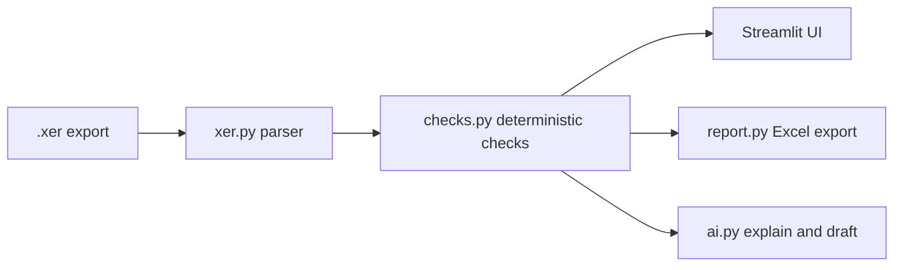

# 📐 P6 Schedule Assistant

Finds errors in **Primavera P6** schedules (`.xer` exports) and explains them in plain language.
Built for a real user: a construction project scheduler who spends hours manually hunting for schedule problems.

> **Design principle:** the checks are deterministic Python (auditable, reproducible). The AI never calculates
> anything; it only explains the computed results and drafts messages. That keeps it trustworthy.

<!-- Add a screenshot / GIF of the app here -->

## What it checks
Based on the DCMA 14-point schedule assessment plus integrity checks:

| Check | Why it matters |
|---|---|
| Missing predecessor / successor | Open ends hide risk and leave dates unsupported |
| Negative lags (leads) and positive lags | Distort the critical path, hide work |
| Non-Finish-to-Start relationships | Fragile logic when overused |
| Hard constraints | Override logic and mask float |
| Negative float, high float, high duration | Missed deadlines, missing logic, activities too long to manage |
| Invalid dates and status inconsistencies | Actuals in the future, unstarted work forecast in the past, "complete" with no finish |
| Dangling and duplicate relationships, circular logic | Broken or unreliable logic |

Every check gives a count, a percentage, a Pass/Review status, the exact activities involved, and an Excel export.

## Run it
```bash
pip install -r requirements.txt
streamlit run app.py        # click "Or try the demo file"
pytest                      # tests run against synthetic data with seeded defects
```

## Deploy free
Push to GitHub, then deploy on **Streamlit Community Cloud** or **Hugging Face Spaces** (point it at `app.py`).
Check each platform's current free-tier terms.

## AI explainer (optional)
Any OpenAI-compatible endpoint: a local model via Ollama (data stays on your machine), or a free-tier cloud model
such as Groq or Gemini. Set it in the sidebar or with the `LLM_API_KEY` environment variable.

## Privacy
Real schedules are confidential. This repo contains **only synthetic demo data** (`sample_data/make_sample.py`).
`.gitignore` blocks real `.xer` files. For real use, run locally with a local model.

## Architecture


## Roadmap
- Critical path / longest path extraction and driving-path tracing
- Compare two schedule versions (what slipped, by how much)
- Auto-generated 2/3-week look-ahead
- Configurable thresholds per company standard
